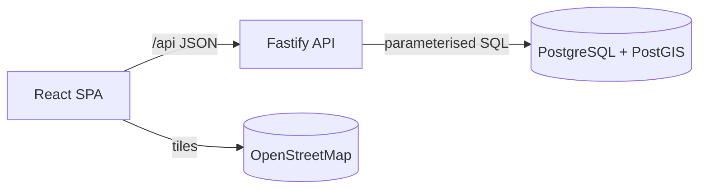

# Wayfare

**South African accommodation discovery and price comparison: a full-stack portfolio project.**

Wayfare helps a traveller find somewhere to stay, either tonight or for a planned trip. It then compares every provider's offer for the same property on the **total price of the stay**, with fees and VAT included and the reasons behind each recommendation shown.

> **Demo data notice.** Every property, provider, price, availability figure and score in Wayfare is **synthetic**. It is generated by a deterministic seed script for demonstration, and nothing can be booked. Map data © OpenStreetMap contributors.


| Offer comparison                                                               | Mobile                                               |
| ------------------------------------------------------------------------------ | ---------------------------------------------------- |
|  |  |

## The problem

Comparing accommodation usually means opening several booking sites. Each one shows a different headline price: one adds a booking fee, another quotes ex-VAT, and the cancellation terms differ. Wayfare demonstrates a comparison tool that:

- Treats a **property** and a provider's **offer** as different things, so the same guesthouse listed by three providers is compared side by side.
- Prices every offer for the **exact stay** (weekend rates, per-stay fees, VAT once) using **one calculation shared by search, filtering, sorting and the detail page**.
- Supports a **last-minute workflow**: "Tonight near me" shows rooms free tonight, nearest first, on a map.

## Features

- **Search:**
  - A destination autocomplete over a local gazetteer of towns, suburbs and landmarks (an ARIA 1.2 combobox).
  - Opt-in browser geolocation, or nationwide browsing.
  - Search state lives in the URL, so searches are shareable and the back button works.
- **Database filters:**
  - Budget, which applies to the average nightly price including fees and VAT.
  - Type of stay, amenities ("has all of"), minimum demo score, free cancellation, bedrooms, distance radius, guest capacity and availability for the dates.
- **Sorting:** recommended (documented formula), price, demo score, and distance. Pagination stays stable under every sort.
- **Map:**
  - Leaflet with price-pill markers and clustering.
  - Selecting a marker highlights its card, and hovering a card highlights its marker.
  - A preview appears for results on other pages.
  - The list keeps working if map tiles fail to load.
- **Offer comparison:**
  - Offers are grouped by room type and show room subtotal, fees, VAT (included or added), total and average per night.
  - Each offer shows its cancellation terms and meal plan.
  - Cheapest and recommended badges come with reasons, and the page warns when those two offers differ in meals or cancellation.
  - Rooms that aren't available say why (booked, too small, minimum stay).
- **Honesty by design:**
  - "Simulated" labels and generation times on every offer, "demo score" labels, and an illustration caption on images.
  - A data provenance panel, and a [How it works](apps/web/src/pages/HowItWorksPage.tsx) page explaining pricing and ranking.
- **Quality:**
  - Responsive from 360 px up.
  - Keyboard accessible, and axe-checked for WCAG A/AA.
  - Loading, empty and error states throughout.

## Tech stack

| Layer       | Choice                                                                                               | Why (see [ADRs](docs/TECHNICAL_DECISIONS.md))                          |
| ----------- | ---------------------------------------------------------------------------------------------------- | ---------------------------------------------------------------------- |
| Frontend    | React 19, Vite 8, TypeScript (strict), React Router 7, TanStack Query 5, CSS Modules + design tokens | URL-driven state, no UI kit, a distinctive design                      |
| Map         | Leaflet 1.9 + leaflet.markercluster (used directly)                                                  | BSD/MIT licences, with the imperative control that clustering needs    |
| API         | Node 24, Fastify 5, Zod 4                                                                            | Layered modules, strict validation, `inject()` for tests               |
| Database    | PostgreSQL 17 + PostGIS 3.5 (Docker)                                                                 | Geography radius search, exclusion constraints, window functions       |
| Data access | `pg` with hand-written, parameterised SQL                                                            | The search is one CTE pipeline; an ORM would get in the way            |
| Shared      | `@wayfare/shared` (npm workspace)                                                                    | API contracts, query schemas and the pricing rules, used by both sides |
| Testing     | Vitest, Testing Library, Playwright, axe-core                                                        | Unit, integration (real DB) and E2E                                    |

## Architecture



```
apps/api      Fastify API: routes → services → repositories (SQL), migrations, seed
apps/web      React app: pages, features (search, filters, results, map, offers), design system
packages/shared  types, Zod schemas, pricing/date/geo/format helpers (used by both)
e2e/          Playwright tests (desktop, mobile, accessibility)
docs/         requirements, architecture, database, API, design system, risks, ADRs, performance
```

- **Search pipeline:** a single SQL statement. It selects candidates (GiST radius), then eligible offers (capacity, minimum nights, availability via `daterange` overlap), then prices them with `quote_stay`, picks the best offer per property, applies the price filter, ranks with window functions, and paginates. Details are in [ARCHITECTURE.md](docs/ARCHITECTURE.md).
- **Data model:** normalised, with composite foreign keys guaranteeing an offer's room and provider listing belong to the same property. Availability blocks use an exclusion constraint. The ER diagram is in [DATABASE_DESIGN.md](docs/DATABASE_DESIGN.md).
- **Pricing:** money is stored as integer cents. VAT is computed once per stay. A TypeScript reference implementation is parity-tested against the SQL function for every seeded offer.

## Getting started (Windows, macOS or Linux)

### Prerequisites

- **Node.js 22.12+**. Developed on Node 24, which includes npm 11.
- **Docker Desktop**, for PostgreSQL + PostGIS. It's free for personal and education use; check Docker's terms for other use. To install PostgreSQL natively instead, see below.
- Git.

### Setup

```bash
git clone https://github.com/MichaelOfKrypton/Wayfare.git
cd Wayfare
cp .env.example .env            # PowerShell: Copy-Item .env.example .env
npm install
npm run db:up                   # starts PostGIS on localhost:54329 (creates wayfare + wayfare_test)
npm run db:reset                # migrate + seed the synthetic dataset
npm run dev                     # API on :4000, web app on :5173
```

Open <http://localhost:5173>.

- **No API keys are needed.** See [`REQUIRED APIS.md`](REQUIRED%20APIS.md) for every configuration item and external service.
- **Offline use:** once dependencies are installed, everything except the map background tiles works without internet.

### One-key start in Cursor / VS Code (F5)

Open the folder and press **F5**, choosing **"Wayfare: run app (Chrome)"** or the Edge variant. The editor then:

1. Runs `scripts/dev-prepare.mjs`, which:
   - creates `.env` if it's missing
   - starts Docker Desktop if needed and starts the database container
   - migrates the schema, and seeds the data if the database is empty
   - stops any leftover Wayfare dev servers on ports 4000 and 5173
2. Starts the API and web app (`npm run dev`) in a terminal panel.
3. Waits until both respond, then opens <http://localhost:5173> in a browser tab with the debugger attached.

Close that browser window, or press **Shift+F5**, to stop the servers. Run `npm install` once before the first F5.

### Useful commands

| Command                                  | What it does                                                                           |
| ---------------------------------------- | -------------------------------------------------------------------------------------- |
| `npm run dev`                            | API (watch mode) and web dev server together                                           |
| `npm run db:reset`                       | Drop, migrate and re-seed the dev database (`SEED_REFERENCE_DATE` pins the dates)      |
| `npm run db:migrate` / `npm run db:seed` | Run either step on its own                                                             |
| `npm test`                               | Unit + integration tests (needs the database running)                                  |
| `npm run test:e2e`                       | Playwright E2E + accessibility tests. Run `npx playwright install chromium` once first |
| `npm run build`                          | Type-check everything and build the web app                                            |
| `npm start`                              | Run the API and serve the production web build (port 4173)                             |
| `npm run lint` / `npm run format`        | ESLint / Prettier                                                                      |
| `npm run images`                         | Regenerate the demo illustrations                                                      |
| `npm run db:down`                        | Stop the database container (data is kept in a Docker volume)                          |

### Without Docker

1. Install PostgreSQL 17 from <https://www.postgresql.org/download/>. On Windows, add PostGIS through the bundled **Stack Builder** (Spatial Extensions).
2. Create a `wayfare` user and the `wayfare` and `wayfare_test` databases.
3. Point `DATABASE_URL` and `TEST_DATABASE_URL` in `.env` at them.

The migrations enable `postgis`, `pg_trgm` and `btree_gist` themselves.

## Testing

| Suite       | Tool                     | Count | Covers                                                                                                                                                                                                                                               |
| ----------- | ------------------------ | ----- | ---------------------------------------------------------------------------------------------------------------------------------------------------------------------------------------------------------------------------------------------------- |
| Unit        | Vitest                   | 62    | Pricing rules and rounding, dates and SAST "today", geo, formatting, query schemas, SQL helpers, recommendation logic, seed determinism                                                                                                              |
| Web unit    | Vitest + Testing Library | 19    | URL state parsing, pagination, the offer comparison component                                                                                                                                                                                        |
| Integration | Vitest + real PostgreSQL | 56    | Every endpoint, plus: an **independent eligibility oracle** (plain SQL vs the production pipeline), every filter and combination, sorting and stable pagination, validation, constraints, SQL↔TypeScript **price parity** across 3,000+ priced stays |
| E2E         | Playwright               | 19    | Search flow, filters, sorting, map ↔ card sync, property and offers, mobile layout, keyboard-only flow, axe-core WCAG A/AA on 4 pages                                                                                                                |

Test results, query plans and the security review are in [docs/PERFORMANCE.md](docs/PERFORMANCE.md).

## Known limitations

- **Synthetic data only.** No live inventory or prices, and no real reviews. The properties are fictional, and their coordinates are approximate points near real places.
- **Simulated availability.** It comes from date-relative blocks generated at seed time; re-seed to move the window forward.
- **Rooms:** "rooms" is modelled as _minimum bedrooms in one unit_. There is no multi-room allocation (ADR-009).
- **Search area:** only places in the local gazetteer (about 40 destinations) can be searched by name. "Use my location" covers the rest of South Africa.
- **Map tiles:** these need internet access and are subject to the OpenStreetMap tile usage policy (light, interactive use only).
- **Out of scope:** no accounts, booking, payments or saved properties.

## Future improvements

- Provider adapters for an **authorised** affiliate or partner feed, with freshness tracking. The data model already separates listings, offers and data status; see `REQUIRED APIS.md` §C for each provider's requirements.
- "Search this area" when panning the map, and saved properties (stored locally).
- Price history and alerts.
- A CI pipeline (GitHub Actions with a PostGIS service container).

## Data, image and licence notes

- **Data:** the dataset is fictional, generated by `apps/api/seed`. Real place names are used only as locations.
- **Images:** original SVG illustrations generated by `apps/web/scripts/generate-demo-images.mjs`. They are not photographs.
- **Third-party assets:**
  - Map data © OpenStreetMap contributors (ODbL).
  - Leaflet (BSD-2-Clause) and leaflet.markercluster (MIT).
  - Inter and Fraunces fonts (SIL OFL).
  - Lucide icons (ISC).
- **Code:** MIT.
