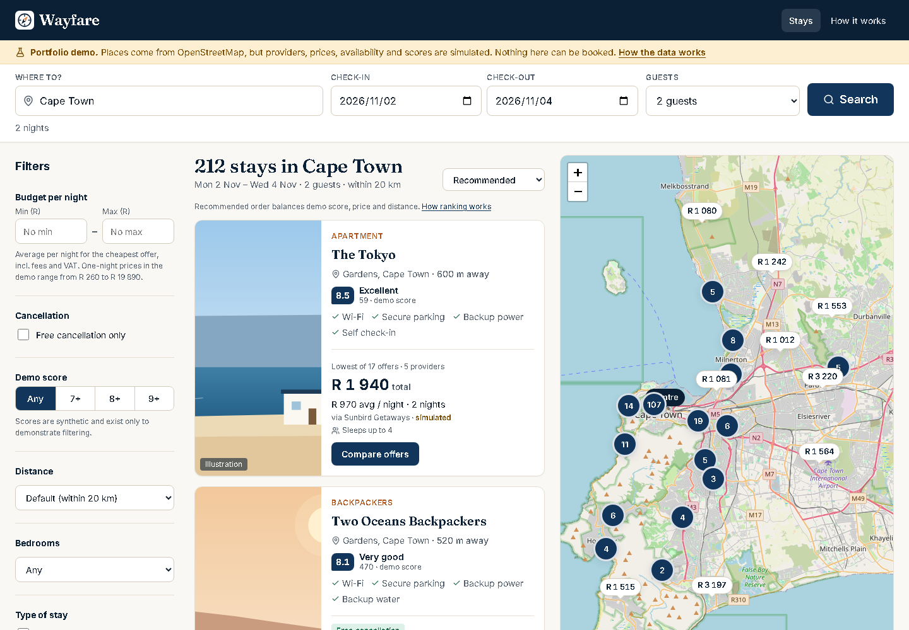
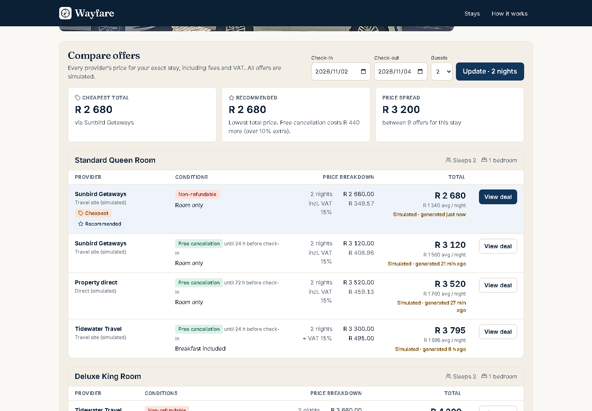
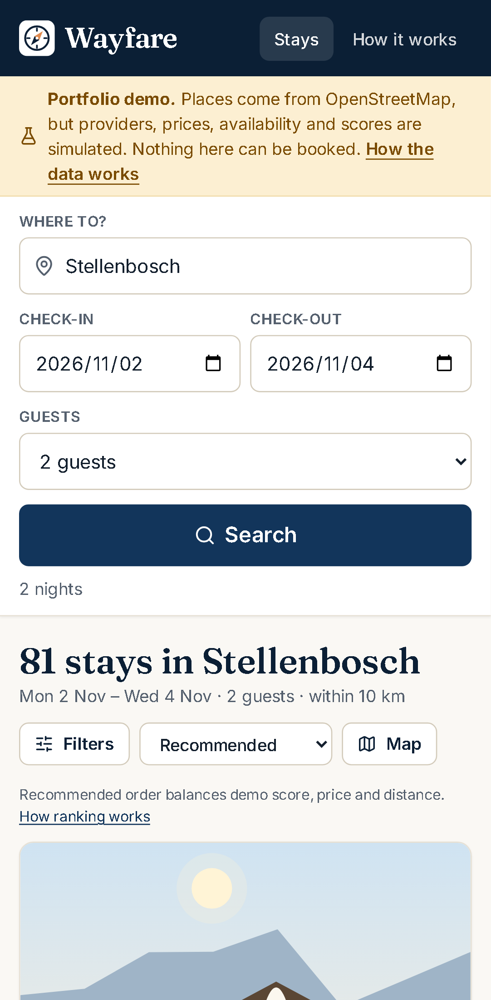

# Wayfare

**Find somewhere to stay in South Africa, and see what it really costs.**

Wayfare is a full-stack accommodation search and price-comparison app. Search by place or by your location, filter and sort on a live map, then open a property to compare every provider's offer on the **total price of the stay**: fees and VAT included, with the reason for each recommendation shown.

> **Real places, simulated prices.** Properties are real South African places from OpenStreetMap, each linking to its own website, with credited Wikimedia Commons photos where available. Providers, prices, availability and scores are simulated, and nothing can be booked. Place and map data © OpenStreetMap contributors.



| Offer comparison                                                               | Mobile                                               |
| ------------------------------------------------------------------------------ | ---------------------------------------------------- |
|  |  |

## Why it exists

Booking sites each show a different headline price. One adds a booking fee, another quotes ex-VAT, and cancellation terms vary. Wayfare compares like with like:

- A **property** is separate from a provider's **offer**, so the same guesthouse listed by three providers is compared side by side.
- Every offer is priced for the **exact stay** (weekend rates, per-stay fees, VAT once), using one calculation shared by search, filters, sorting and the detail page.
- **"Tonight near me"** shows rooms free tonight, nearest first.

## Highlights

- **Search:** destination autocomplete, opt-in geolocation, and search state in the URL so links are shareable.
- **Filters and sorting:** budget (all-in nightly price), type of stay, amenities, score, free cancellation, bedrooms, radius, guests and dates. Sort by recommended, price, score or distance.
- **Map:** Leaflet with price markers and clustering, kept in sync with the result cards.
- **Offer comparison:** room subtotal, fees, VAT, total and per-night price; cancellation and meals; "cheapest" and "recommended" badges with reasons.
- **Real places:** names, locations, star ratings, websites and phone numbers from OpenStreetMap, with every imported link and field sanitised. Free-licence photos come from Wikimedia Commons, each with its credit.
- **Built for load:** a response cache with request coalescing, pre-compressed responses, ETags and multi-process mode. In the [load test](docs/PERFORMANCE.md#3-concurrency-and-load) it served about 4,900 requests/s across 1,742 real places with zero errors at 2,000 concurrent connections.
- **Accessible and responsive:** keyboard-friendly, axe-checked for WCAG A/AA, works from 360 px wide.
- **Tested:** about 150 unit, integration and end-to-end tests, including a check that the SQL and TypeScript pricing agree on every seeded offer.

## Tech stack

| Layer    | Choice                                                                |
| -------- | --------------------------------------------------------------------- |
| Frontend | React 19, Vite, TypeScript, React Router, TanStack Query, CSS Modules |
| Map      | Leaflet + leaflet.markercluster, OpenStreetMap tiles                  |
| API      | Node 24, Fastify 5, Zod                                               |
| Database | PostgreSQL 17 + PostGIS (Docker), hand-written parameterised SQL      |
| Shared   | `@wayfare/shared` workspace: API types, schemas and pricing rules     |
| Testing  | Vitest, Testing Library, Playwright, axe-core                         |

```
apps/api         Fastify API, SQL migrations and the seed generator
apps/web         React app
packages/shared  Types, schemas and pricing helpers used by both
e2e/             Playwright tests
docs/            Requirements, architecture, database, API, design and decisions
```

## Run it locally

You need **Node.js 22.12+**, **Docker Desktop** and Git. No API keys are required.

```bash
git clone https://github.com/MichaelOfKrypton/Wayfare.git
cd Wayfare
cp .env.example .env     # PowerShell: Copy-Item .env.example .env
npm install
npm run db:up            # start PostgreSQL + PostGIS
npm run db:reset         # create the schema and load demo data
npm run dev              # API on :4000, app on :5173
```

Then open <http://localhost:5173>.

**VS Code / Cursor:** after `npm install`, press **F5** and pick **"Wayfare: run app"**. It starts the database, prepares the data, runs both servers and opens the browser. **Shift+F5** stops everything.

| Command                  | What it does                                            |
| ------------------------ | ------------------------------------------------------- |
| `npm run dev`            | Run the API and web app in watch mode                   |
| `npm run db:reset`       | Rebuild and re-seed the database                        |
| `npm test`               | Unit and integration tests (database must be up)        |
| `npm run test:e2e`       | Browser tests (`npx playwright install chromium` first) |
| `npm run build`          | Type-check and build                                    |
| `npm run loadtest`       | Load test with 1,000 concurrent connections             |
| `npm run data:fetch-osm` | Refresh the OpenStreetMap snapshot (optional)           |
| `npm run db:down`        | Stop the database                                       |

Prefer not to use Docker? Install PostgreSQL 17 with PostGIS, create `wayfare` and `wayfare_test` databases, and point `DATABASE_URL` / `TEST_DATABASE_URL` in `.env` at them.

## Limitations

- Prices, availability, rooms and providers are simulated. Place details are only as complete as OpenStreetMap, so some places have no website or photo.
- 1,742 real places across 29 towns and cities; "Use my location" searches anywhere nearby.
- No accounts, booking or payments.

## Roadmap

- Real prices and outbound booking links through an approved affiliate or partner programme. The provider options are compared in [`REQUIRED APIS.md`](REQUIRED%20APIS.md).
- "Search this area" on the map, saved properties, price alerts and CI.

## Documentation

[Architecture](docs/ARCHITECTURE.md) · [Database](docs/DATABASE_DESIGN.md) · [API](docs/API_SPECIFICATION.md) · [Design system](docs/DESIGN_SYSTEM.md) · [Decisions](docs/TECHNICAL_DECISIONS.md) · [Performance & security](docs/PERFORMANCE.md) · [Requirements](docs/PRODUCT_REQUIREMENTS.md)

## Credits and licence

Place and map data © OpenStreetMap contributors (ODbL). Photos from Wikimedia Commons are credited individually under their own licences. Leaflet (BSD-2-Clause), leaflet.markercluster (MIT), Inter and Fraunces fonts (SIL OFL), Lucide icons (ISC). Other images are original illustrations, labelled as such.

Code is released under the [MIT licence](LICENSE).
