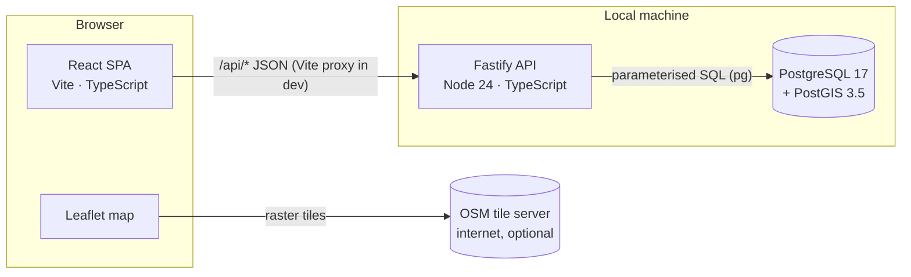
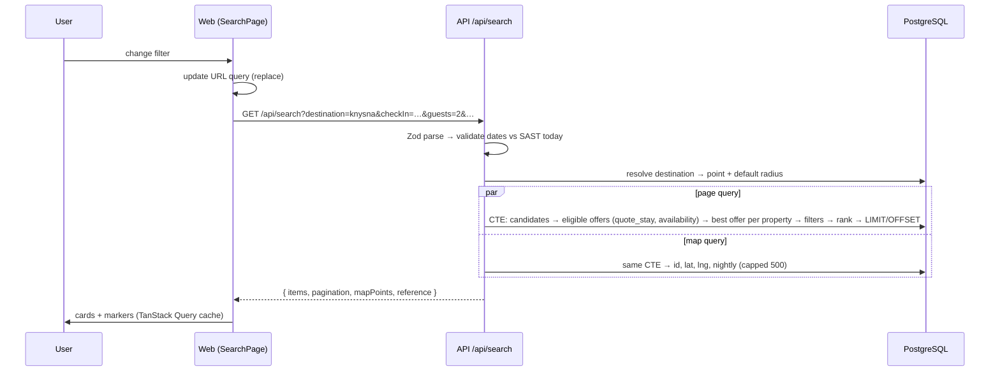

# Architecture — Wayfare

## 1. Overview



There are three deployable parts, all local:

| Part | Location | Responsibility |
|---|---|---|
| **Web** | `apps/web` | UI, URL-driven search state, map, presentation formatting |
| **API** | `apps/api` | Validation, search, ranking, pricing (via SQL), error handling |
| **Database** | Docker `postgis/postgis:17-3.5` | Storage, geospatial indexing, availability, stay pricing |
| **Shared** | `packages/shared` | API contract types, Zod query schemas, the pricing reference implementation, formatting |

## 2. Repository layout

```
apps/
  api/
    src/
      app.ts               buildApp(): Fastify instance (used by server and tests)
      server.ts            process entry point
      config.ts            env parsing (Zod)
      db/                  pool, migration runner, SQL migrations
      lib/                 errors, clock (SAST "today"), SQL helpers
      modules/
        destinations/      routes → repository
        filters/           filter metadata
        search/            routes → service → repository (query builder)
        properties/        details + offers comparison
        health/
    seed/                  deterministic synthetic dataset + seeder
    test/                  integration tests (real PostgreSQL)
  web/
    src/
      app/                 router, providers, layout
      pages/               Home, Search, Property, HowItWorks, NotFound
      features/            search-form, filters, results, map, offers, gallery
      components/          design-system primitives (Button, Chip, Dialog…)
      lib/                 api client, query hooks, url-state, geolocation
      styles/              tokens.css, global.css
packages/shared/src/       contracts.ts, search-schema.ts, pricing.ts, geo.ts, format.ts
e2e/                       Playwright specs
docs/                      this documentation
```

## 3. Frontend architecture

- **React 19 + Vite 8 + TypeScript (strict).**
- **Routing:** React Router — `/`, `/search`, `/properties/:slug`, `/how-it-works`, `*`.
- **State:**
  - Search parameters live in the **URL query string**. It is the single source of truth: shareable, safe to reload, and the back button works.
  - Server data is fetched and cached with **TanStack Query**, keyed by the normalised parameters.
  - The selected or hovered property for map ↔ list sync is local state in the results page.
- **Validation:** the URL is parsed with the same Zod schema the API uses (`@wayfare/shared`), so invalid URLs degrade to defaults with a visible notice instead of crashing.
- **Styling:** plain CSS with **CSS custom-property design tokens** (`tokens.css`) and CSS Modules per component. No UI framework (ADR-006).
- **Map:** Leaflet and `leaflet.markercluster`, used directly through a small `useLeafletMap` hook (ADR-005).
- **Icons:** `lucide-react` (ISC). **Fonts:** self-hosted via `@fontsource-variable` (OFL), so they work offline.

## 4. Backend architecture

- **Fastify 5** with a layered module structure. A request flows like this:
  1. The **route** parses and validates input with Zod (`@wayfare/shared` schemas) and maps it to a typed command.
  2. The **service** holds the business rules: date-range validation against "today" in SAST, sort availability, and response shaping.
  3. The **repository** holds the SQL. Queries are parameterised and built by a small helper that only accepts values as bound parameters (`$n`).
- **Plugins:** `@fastify/helmet` (security headers), `@fastify/cors` (dev origin only), `@fastify/rate-limit` (in-memory).
- **Errors:** one error handler maps the error classes below to a consistent envelope (see API spec §2):
  - `AppError` subclasses (`ValidationError`, `NotFoundError`) → their declared status.
  - Zod errors → 400 with field issues.
  - Anything else → a 500 with a generic message. Details go to the server log (pino) only.
- **Clock:** `lib/clock.ts` computes "today" in `Africa/Johannesburg`. It is injectable in tests.

## 5. Database architecture

PostgreSQL 17 with PostGIS (`geography(Point,4326)`), `pg_trgm` for autocomplete and `btree_gist` for availability exclusion constraints. The full design is in [DATABASE_DESIGN.md](DATABASE_DESIGN.md).

The key decision is that stay pricing is a **SQL function** (`quote_stay`). Filtering, sorting and the offer comparison all use the same calculation, so a list price can never disagree with a detail price. `packages/shared/src/pricing.ts` is a reference TypeScript implementation of the same rules. An integration test asserts that both agree for every seeded offer across several date ranges.

## 6. Data flow — search



**The search pipeline in SQL** (one statement; `apps/api/src/modules/search/search.repository.ts`):

1. **candidates**: properties inside the radius (`ST_DWithin` on a GiST-indexed geography), matching type, amenities (all-of), score and name filters.
2. **eligible_offers**: active offers for candidates where the room fits the guests and minimum bedrooms, the stay meets `min_nights`, the room is not blocked over `[checkIn, checkOut)`, and the policy matches if free cancellation is required. Each one is priced by `quote_stay` through a `LATERAL` join.
3. **per_property**: the cheapest eligible offer per property (`DISTINCT ON`), plus offer and provider counts.
4. **filtered**: the nightly-price range is applied to `total / nights`.
5. **ranked**: the recommended score is computed with `percent_rank()` window functions, along with `count(*) OVER ()` for pagination.
6. **The final SELECT** orders by the chosen sort with `id` as the tie-breaker, applies LIMIT/OFFSET, and pulls the cover image and the top amenities through correlated subqueries. This covers the page's rows only, so there is no N+1.

## 7. Map interaction flow

- `mapPoints` covers **all** matches (up to 500), not just the current page, so the map shows the full picture while the list paginates.
- Markers are `L.divIcon` price pills, grouped with `leaflet.markercluster`.
- **Marker click** → `selectedId` → the card is highlighted and scrolled into view (if it's on the current page). If it isn't on the page, a compact preview card is shown over the map.
- **Card hover/focus** → `hoveredId` → the marker gets an emphasised style and moves to the top of the z-order.
- **Tile errors** → a non-blocking "Map tiles unavailable" notice. The list stays fully usable.
- **Accessibility:** the list is the primary interface and the map is supplementary. Markers are keyboard-focusable (Leaflet `keyboard: true`) and have an `aria-label`.

## 8. Property ↔ offer relationships

```
Property 1──* RoomType
Property 1──* ProviderListing *──1 Provider     (how a provider lists this property)
Offer *──1 RoomType, Offer *──1 ProviderListing  (composite FKs guarantee same property)
```

A **provider listing** is the record of *one provider listing one property*. This is where matching the same property across providers would live in a future integration: `(provider_id, external_ref)` is unique. **Offers** are priced products, one per room type, meal plan and cancellation policy.

## 9. Error-handling strategy

| Layer | Strategy |
|---|---|
| API input | Zod → 400 `VALIDATION_ERROR` with `issues[] {path, message}` |
| Business rules | `ValidationError` (e.g. check-in in the past), `NotFoundError` (unknown slug) |
| Database / unexpected | Logged with request id. Client gets 500 `INTERNAL_ERROR`, generic message |
| DB unavailable | `/api/health/ready` → 503. Searches → 503 `SERVICE_UNAVAILABLE` |
| Web data fetching | TanStack Query error → `ErrorState` with retry. 404 → dedicated not-found state |
| Map | Tile error notice. Map failure never blocks the list |
| Geolocation | Denied, unavailable or timed out → inline message, focus moves to manual destination input |

## 10. Testing strategy

| Level | Tool | Scope |
|---|---|---|
| Unit | Vitest | `pricing`, `geo`, `format`, search schema validation, SQL builder, ranking helpers, URL-state mapping, React components (Testing Library) |
| Integration | Vitest + real PostgreSQL (`wayfare_test`) + `fastify.inject` | Every endpoint, combined filters, pagination, sorting, invalid params, empty results, SQL ↔ TS price parity, constraints |
| E2E | Playwright (Chromium) | Home → search → filter → sort → map ↔ card → property → offers, mobile viewport, invalid input |

Integration tests migrate and seed `wayfare_test` with the same deterministic seed, using **today** as the reference date, so date-relative availability is reproducible.

## 11. Local development

See the [README](../README.md). In short:
1. `docker compose up -d`
2. `npm install`
3. `npm run db:reset`
4. `npm run dev`

That serves the web app at <http://localhost:5173> and the API at <http://localhost:4000>.

## 12. Future provider-integration strategy

A provider adapter would implement:

```ts
interface ProviderAdapter {
  code: string;                                   // matches providers.slug
  fetchListings(area: BoundingBox): Promise<ExternalListing[]>;
  fetchOffers(listingRefs: string[], stay: StayQuery): Promise<ExternalOffer[]>;
}
```

The pipeline would run in four stages:
1. **Ingest:** a scheduled job outside the request path writes `provider_listings` and `offers` with `data_status = 'cached'` and `last_checked_at`.
2. **Match:** external listings are matched to existing `properties` by distance (< 75 m), normalised name similarity (`pg_trgm`) and address. Anything below the confidence threshold goes to a review queue rather than being merged automatically.
3. **Freshness:** offers older than a threshold are shown as "price may have changed" and excluded from "cheapest" claims.
4. **Legal:** no adapter is built until the provider's terms explicitly permit the use. See `REQUIRED APIS.md` §C.
