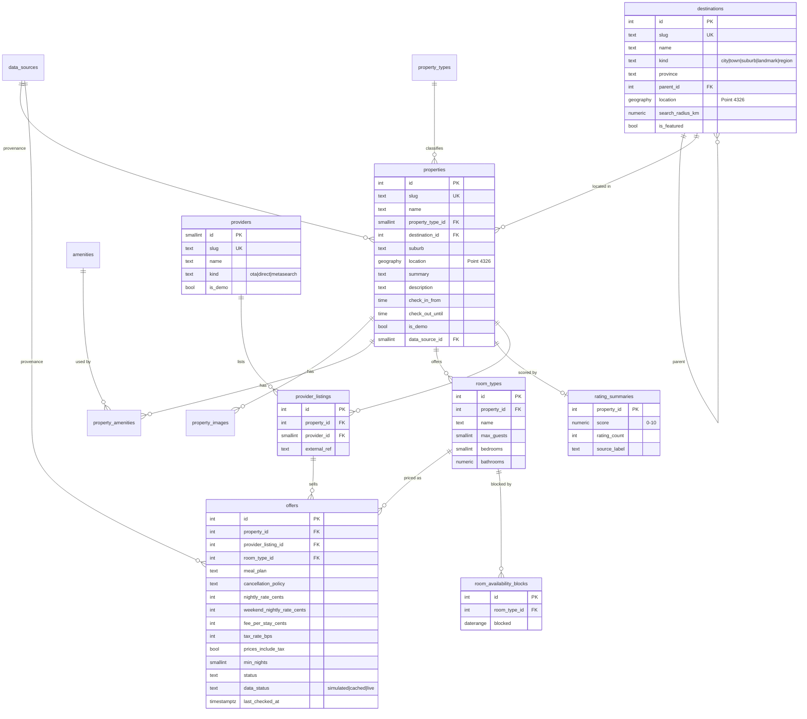

# Database Design — Wayfare

PostgreSQL 17 + PostGIS 3.5. The schema is created by ordered SQL migrations in `apps/api/src/db/migrations`, which the runner records in `schema_migrations`. The seed (`apps/api/seed`) is deterministic.

## 1. ER diagram

## 2. Tables

| Table                      | Purpose                                                                                                       | Notable constraints / indexes                                                                                                                                                                     |
| -------------------------- | ------------------------------------------------------------------------------------------------------------- | ------------------------------------------------------------------------------------------------------------------------------------------------------------------------------------------------- |
| `data_sources`             | Where a record came from: `synthetic-demo` (fictional) or `openstreetmap` (`open_data`, real places)          | `code` unique; `kind` check                                                                                                                                                                       |
| `destinations`             | Searchable places: cities, towns, suburbs, landmarks                                                          | `slug` unique; GiST on `location`; GIN trigram on `name`; radius check `(0,200]`                                                                                                                  |
| `property_types`           | Hotel, guesthouse, B&B, lodge, self-catering, holiday home, farm stay, boutique hotel, backpackers, apartment | `slug` unique                                                                                                                                                                                     |
| `amenities`                | Wi-Fi, parking, pool, braai area, backup power, etc.                                                          | `slug` unique; `category` check                                                                                                                                                                   |
| `properties`               | The physical establishment. Real places also store `osm_type`/`osm_id`, `website_url`, `phone` and `stars`    | `slug` unique; `(destination_id, lower(name))` unique for fictional rows; `(osm_type, osm_id)` unique; `CHECK`s on website (plain `http(s)` host), phone format and stars 1–5; GiST on `location` |
| `property_images`          | Ordered gallery; `alt_text NOT NULL`; `credit`, `credit_url`, `licence` for Wikimedia photos                  | `(property_id, sort_order)` unique; `credit_url` must be a Commons page                                                                                                                           |
| `property_amenities`       | M:N join table; `is_verified` marks amenities confirmed by OpenStreetMap                                      | PK `(property_id, amenity_id)`; index on `amenity_id`                                                                                                                                             |
| `room_types`               | Bookable unit types within a property                                                                         | `(property_id, name)` unique; capacity checks; unique `(id, property_id)` for the composite FK                                                                                                    |
| `rating_summaries`         | Aggregate **synthetic** score per property (optional, 1:0..1)                                                 | `score` 0–10; `rating_count ≥ 0`                                                                                                                                                                  |
| `providers`                | Booking channels (fictional in MVP)                                                                           | `slug` unique                                                                                                                                                                                     |
| `provider_listings`        | One provider's listing of one property. This is where cross-provider matching happens                         | `(property_id, provider_id)` unique; `(provider_id, external_ref)` unique                                                                                                                         |
| `offers`                   | A priced product: listing × room type × meal plan × cancellation policy                                       | Composite FKs (see §3); money checks; unique product key; partial index on active offers                                                                                                          |
| `room_availability_blocks` | Dates a room type is unavailable (simulated)                                                                  | `EXCLUDE USING gist (room_type_id WITH =, blocked WITH &&)` stops overlapping blocks                                                                                                              |
| `schema_migrations`        | Migration bookkeeping                                                                                         | `version` PK                                                                                                                                                                                      |

## 3. Key design decisions

1. **Property ≠ offer.** A property exists independently of who sells it. Offers belong to a `provider_listing` _and_ a `room_type`. `offers.property_id` is denormalised so search can join directly, and its consistency is **enforced** with composite foreign keys:
   - `(room_type_id, property_id) → room_types(id, property_id)`
   - `(provider_listing_id, property_id) → provider_listings(id, property_id)`

   An offer therefore can never combine one property's room with another property's listing.

2. **Money as integer cents** (`int`, ZAR only, `currency` check). This avoids floating-point drift. Rates are stored the way a provider would quote them:
   - `nightly_rate_cents`
   - an optional `weekend_nightly_rate_cents` (Friday and Saturday nights)
   - `fee_per_stay_cents` (cleaning or admin, once per stay)
   - `tax_rate_bps` (VAT, 1500 = 15%)
   - `prices_include_tax`
3. **One pricing implementation in SQL.** `quote_stay(nightly, weekend, fee, tax_bps, include_tax, check_in, check_out)` is an `IMMUTABLE` SQL function. It returns `nights, weekend_nights, room_subtotal_cents, fees_cents, tax_cents, total_cents`. The rules are:
   - `room_subtotal = Σ nightly rate per night`, using the weekend rate for Friday and Saturday nights where one is set.
   - `taxable = room_subtotal + fees`.
   - When **prices include tax**: `tax = round(taxable × bps / (10000 + bps))` (the included portion, for information only) and `total = taxable`.
   - Otherwise `tax = round(taxable × bps / 10000)` and `total = taxable + tax`.
   - Tax is calculated **once per stay**, never per night, so there is no compounding of rounding.

   `packages/shared/src/pricing.ts` mirrors these rules, and an integration test proves parity.

4. **Geography, not geometry.** `geography(Point,4326)` gives metre-accurate `ST_DWithin` and `ST_Distance` on the spheroid without projection choices. The scale is national, and GiST indexes make radius searches index-assisted. Latitude and longitude for the API come from `ST_Y/ST_X(location::geometry)`. A check constraint keeps points within South Africa's bounding box (lat −35.5…−21.5, lng 16…33.5), which catches swapped or garbage coordinates.
5. **Availability as exclusion-constrained date ranges.** `daterange` with `[)` bounds matches hotel semantics (check-out day is free). An offer is unavailable when its room type has a block that overlaps `daterange(check_in, check_out, '[)')`. The `btree_gist` exclusion constraint makes overlapping blocks impossible.
6. **Text + CHECK instead of ENUM types.** Enumerations such as `meal_plan`, `cancellation_policy` and `kind` are `text` with `CHECK (col IN (…))`. This is easier to evolve in migrations than `ALTER TYPE`, and just as safe.
7. **Ratings are a separate optional table**, labelled with `source_label` ("Synthetic demo score"). There is no review text, so there are no fabricated experiences. Properties without a row display "Not yet rated".
8. **Duplicate prevention:**
   - `slug` is unique.
   - `(destination_id, lower(name))` is unique.
   - The `(provider_id, external_ref)` and `(property_id, provider_id)` uniques stop one provider listing the same property twice.
   - The offer product key `(provider_listing_id, room_type_id, meal_plan, cancellation_policy)` is unique.
   - The seed validator also rejects two properties within 30 m of each other.
9. **Timestamps.** `created_at` and `updated_at` default to `now()`, and a shared trigger function sets `updated_at` on update.
10. **What was left out:**
    - No `cities`/`provinces` tables: the province is a checked text column on `destinations`.
    - No separate `prices` history table: the MVP needs no history.
    - No users or bookings tables: these are out of scope.

## 4. Index strategy

| Query                        | Index                                                                             |
| ---------------------------- | --------------------------------------------------------------------------------- |
| Radius search                | GiST `properties(location)`                                                       |
| Destination autocomplete     | GIN `destinations(name gin_trgm_ops)` + btree `slug`                              |
| Type filter                  | btree `properties(property_type_id)`                                              |
| Amenity filter               | PK `property_amenities(property_id, amenity_id)` + btree `(amenity_id)`           |
| Eligible offers per property | btree `offers(property_id) WHERE status = 'active'`                               |
| Availability check           | the GiST exclusion index on `(room_type_id, blocked)` doubles as the lookup index |
| Offers by room / listing     | btree FK indexes                                                                  |

`EXPLAIN ANALYZE` output for the main search is recorded in [PERFORMANCE.md](PERFORMANCE.md) after implementation.

## 5. Seed data

- **Deterministic:** a seeded PRNG (mulberry32, fixed seed) generates the variations. `SEED_REFERENCE_DATE` (default: today in SAST) anchors the date-relative availability blocks and the `last_checked_at` times.
- **Two datasets.** With `SEED_DATASET=auto` (the default), `db:seed` loads the committed OpenStreetMap snapshot when it exists (`apps/api/seed/osm/`), and otherwise the fictional set. Tests always use the fictional set, so their expectations stay fixed.
- **Real places:** `properties.is_demo = false` and `data_source = openstreetmap`. Name, location, type, stars, website, phone, address and confirmed amenities come from OSM. Rooms, offers, availability, scores and the other amenities are generated by the same deterministic generator, seeded from the OSM id.
- **Statistics:** the seed runs `ANALYZE` on every table, because the planner otherwise guesses single-row results on fresh tables.
- **Fictional places:** every row references the `synthetic-demo` data source, and `properties.is_demo = true`.
- The images are original SVG illustrations generated by `apps/web/scripts/generate-demo-images.mjs` and committed under `apps/web/public/images/demo/`.
